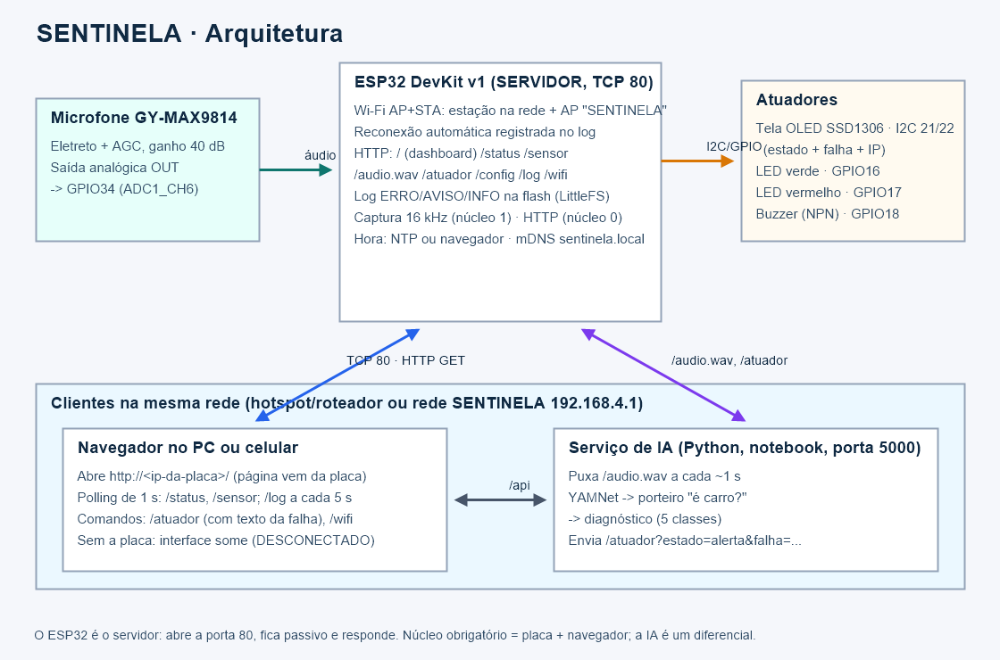
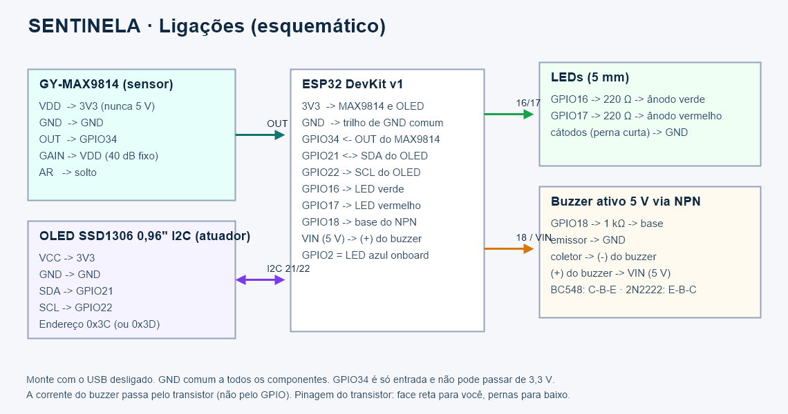
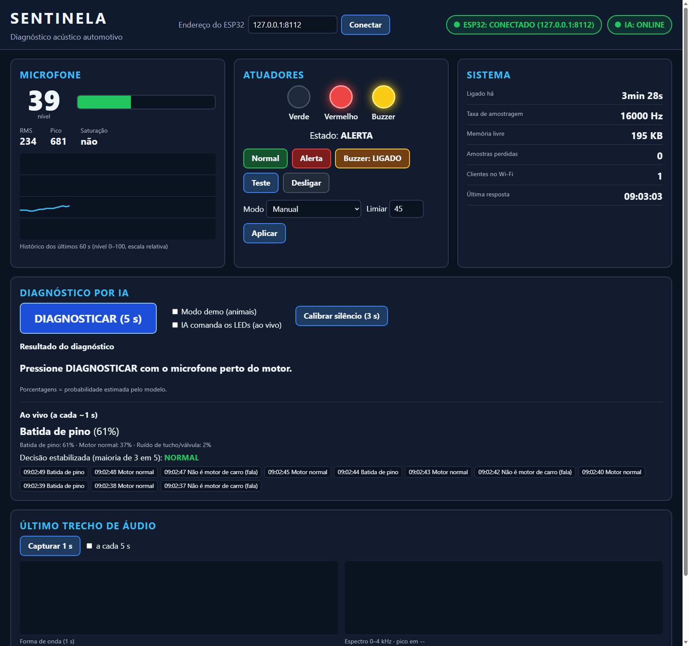

# SENTINELA — Diagnóstico acústico automotivo

Sistema ciberfísico que **escuta o motor** e ajuda a diagnosticar falhas. Um microfone (GY-MAX9814) ligado a um **ESP32** capta o som. O ESP32 é o **servidor** do sistema: abre a porta TCP 80, entrega a própria interface web (dashboard), as leituras do microfone e trechos de áudio, e recebe comandos para os atuadores — **tela OLED SSD1306**, LEDs e buzzer. Ele se conecta a uma rede Wi-Fi (e se reconecta sozinho, registrando quedas com data e hora num **log persistente na flash**) e mantém a rede própria `SENTINELA` como reserva. Um **serviço de IA** local (YAMNet + classificador) responde três perguntas sobre o áudio: *é som de carro?*, *está normal?* e *se não, qual a falha provável?* — e manda o resultado para a tela da placa.

> Apoio à decisão — não substitui um mecânico. As porcentagens exibidas são **probabilidade estimada pelo modelo**.

Disciplina: Conectividade em Sistemas Ciberfísicos (TDE) — Engenharia de Software, PUCPR. Professor: Fábio Bettio.

## Integrantes

| Nome | RA |
|---|---|
| Leonardo Farias Ribeiro | [RA] |
| Leonardo Silva Sobrinho | [RA] |
| Nathan Banach | [RA] |

## Arquitetura



- **ESP32 = servidor TCP/HTTP** (requisito central): `WebServer` em modo passivo na **porta 80**, aceitando conexões de clientes (navegador no PC ou celular, `curl`, serviço de IA). Pilha usada: Wi-Fi 802.11 → IPv4 → **TCP** → **HTTP/1.1**.
- **Wi-Fi em modo AP+STA**: como **estação**, a placa entra numa rede existente (roteador ou hotspot do celular), recebe IP por DHCP, acerta o relógio por NTP e **se reconecta sozinha** se a rede cair, registrando queda e reconexão no log. Como **ponto de acesso**, mantém a rede `SENTINELA` (senha `sentinela123`, IP `192.168.4.1`) como plano B. A rede da estação é configurada pelo próprio dashboard (fica salva na NVS).
- **A interface roda na placa**: `http://<ip-da-placa>/` (ou `http://sentinela.local/`) entrega o dashboard, embutido na flash e comprimido. Com o ESP32 desligado, a página não abre; se ele cair com a página aberta, a interface inteira some atrás do aviso "ESP32 DESCONECTADO" e volta sozinha.
- **Log persistente** (LittleFS): toda ocorrência é gravada como `ERRO`, `AVISO` ou `INFO`, com data e hora. Acesso pela rota `/log` e pelo painel do dashboard.
- **Diferencial (IA)**: `src/ai/server.py` roda no notebook (porta 5000), puxa áudio do ESP32, classifica e comanda o alerta e o texto da falha na tela. Se cair, o núcleo continua funcionando.
- **Offline**: nenhum CDN, fonte externa ou chamada à internet em tempo de execução (a internet só é usada, se existir, para o NTP).

```text
sentinela/
├── docs/            # relatório ABNT, API, decisões, diagramas, métricas, montagem, checklist, evidências
├── src/
│   ├── esp32/
│   │   ├── esp32_server/   # firmware: esp32_server.ino (servidor HTTP e rotas),
│   │   │                   #   rede.* (Wi-Fi AP+STA), registro_log.* (log na flash),
│   │   │                   #   tela_oled.* (SSD1306), captura_audio.* (ADC 16 kHz),
│   │   │                   #   atuadores.* (LEDs/buzzer), pagina_web.h (dashboard gerado)
│   │   └── teste_audio/    # teste isolado do microfone
│   ├── client/      # dashboard: index.html, app.js, style.css (JS puro, sem build)
│   └── ai/          # server.py, train.py, prepare_dataset.py, record.py, analise.py, ...
├── tools/           # gerar_pagina_esp32.py, coletar_evidencias.ps1, mock_esp32.py, teste_fase1.py, ...
├── models/          # classificador.joblib + classes.json (o YAMNet não é versionado)
└── data/            # áudios brutos e de treino (não versionado)
```

## Hardware e pinagem



| Componente | Pino do ESP32 | Ligação |
|---|---|---|
| ESP32 DevKit v1 (WROOM-32, 30 pinos, sem PSRAM) | — | USB do notebook ou power bank 5000 mAh |
| GY-MAX9814 (sensor) VDD / GND | 3V3 / GND | **Nunca 5 V** |
| GY-MAX9814 OUT | **GPIO34** | ADC1_CH6 (o ADC2 não funciona com Wi-Fi) |
| GY-MAX9814 GAIN / AR | VDD / solto | Ganho fixo de 40 dB |
| **OLED SSD1306 0,96" I2C** (atuador) VCC / GND | 3V3 / GND | Módulo de 4 pinos, endereço 0x3C (ou 0x3D) |
| OLED SDA / SCL | **GPIO21 / GPIO22** | Barramento I2C a 400 kHz |
| LED verde | **GPIO16** | 220 Ω → ânodo; cátodo → GND |
| LED vermelho | **GPIO17** | 220 Ω → ânodo; cátodo → GND |
| Buzzer ativo 5 V | **GPIO18** | 1 kΩ → base do BC548 (face lisa: C-B-E); emissor → GND; coletor → (−) do buzzer; (+) → VIN |
| LED azul onboard | GPIO2 | Espelha o alerta |

A tela OLED é o atuador exigido pelo regulamento (LEDs e buzzer não contam): mostra o **estado atual** (NORMAL / ALERTA / DESLIGADO / TESTE), o **texto da falha** recebido pela rede, o IP para acessar a placa, a hora e o nível do microfone. O firmware funciona sem ela e a reconhece se for ligada depois. Montagem passo a passo: **[docs/MONTAGEM_SEGUNDA.md](docs/MONTAGEM_SEGUNDA.md)**.

## API do ESP32 (somente GET, porta 80)

Documentação completa, incluindo o serviço de IA: **[docs/API.md](docs/API.md)**. Respostas JSON trazem `Access-Control-Allow-Origin: *` e `Cache-Control: no-store`. Erros vêm em JSON (400 para parâmetro inválido, 404 para rota inexistente) e são registrados como AVISO no log.

| Rota | Função |
|---|---|
| `/` | Dashboard (HTML+CSS+JS embutidos, gzip) |
| `/status` | IP e MAC (estação e AP), rede e sinal, data/hora, uptime, taxa de amostragem, memória, estado dos atuadores e da tela |
| `/sensor` | RMS, pico, nível 0–100 e clipping da última janela de ~250 ms |
| `/audio.wav?ms=1000` | Trecho mais recente em WAV PCM 16-bit mono (200–2000 ms) |
| `/atuador?estado=normal\|alerta\|off\|teste[&buzzer=0\|1][&falha=texto]` | Comanda tela OLED, LEDs e buzzer |
| `/config?modo=auto\|manual&limiar=0-100` | Modo automático local por nível (fallback sem IA) |
| `/log?linhas=100` · `/log?completo=1` | Log persistente (ERRO/AVISO/INFO com data e hora) |
| `/wifi?ssid=...&senha=...` | Rede Wi-Fi da estação (salva na NVS; `ssid=` vazio esquece) |
| `/relogio?epoch=...` | Acerta a data/hora quando não há NTP (o dashboard faz isso sozinho) |
| `/info` | Nome, versão e lista de rotas |

```powershell
curl.exe http://192.168.4.1/sensor
curl.exe "http://192.168.4.1/atuador?estado=alerta&falha=Batida%20de%20pino"
curl.exe "http://192.168.4.1/log?linhas=20"
```

## Instalação e execução

### 1. Firmware (Arduino CLI + core ESP32 2.0.17)

```powershell
# Se ainda não houver o Arduino CLI portátil em .tools\ (ver docs/DECISOES.md):
arduino-cli config add board_manager.additional_urls https://espressif.github.io/arduino-esp32/package_esp32_index.json
arduino-cli core install esp32:esp32@2.0.17
arduino-cli lib install "Adafruit SSD1306@2.5.13"      # traz Adafruit GFX e BusIO

.venv\Scripts\python tools\gerar_pagina_esp32.py       # SEMPRE que mudar algo em src\client
$cli = ".tools\arduino-cli\arduino-cli.exe"; $cfg = ".tools\arduino-cli\arduino-cli.yaml"
& $cli --config-file $cfg compile --fqbn esp32:esp32:esp32 src/esp32/esp32_server
& $cli --config-file $cfg upload -p COM6 --fqbn esp32:esp32:esp32 src/esp32/esp32_server
```

Nesta placa a gravação só entra em modo de download **segurando o botão BOOT** durante todo o upload (ver [docs/MONTAGEM_SEGUNDA.md](docs/MONTAGEM_SEGUNDA.md)).

### 2. Acessar a placa (PC ou celular)

1. Conecte-se ao Wi-Fi **SENTINELA** (senha `sentinela123`) e abra **http://192.168.4.1/**.
2. Em *Sistema → Configurar rede Wi-Fi da placa*, informe a rede do roteador ou do hotspot. A placa conecta, mostra o novo IP **na tela OLED** e no dashboard.
3. Na mesma rede, acesse **http://\<IP mostrado\>/** (ou `http://sentinela.local/`).

### 3. Serviço de IA (Python 3.11, opcional)

```powershell
py -3.11 -m venv .venv
.venv\Scripts\python -m pip install -r src\ai\requirements.txt
.venv\Scripts\python tools\baixar_yamnet.py                       # 1 vez, com internet
.venv\Scripts\python src\ai\server.py --esp32 192.168.4.1         # ou o IP da placa na rede
```

Atalho: **duplo clique em `tools\iniciar_ia.bat`**. O painel de IA do dashboard funciona no notebook que roda o serviço (no Chrome/Edge, aceite "acessar dispositivos da rede local" se for perguntado); no celular ele aparece como offline e o resto funciona normalmente.

Treino (reproduzível, já existe um modelo treinado em `models/`):

```powershell
.venv\Scripts\python src\ai\prepare_dataset.py       # data/raw/* -> data/train/ (ver docs/DATASETS.md)
.venv\Scripts\python src\ai\train.py                 # -> models/ e docs/metricas_ia.md
.venv\Scripts\python src\ai\record.py --classe normal --segundos 60   # grava áudio rotulado pela placa
```

### 4. Sem a placa (simulador, só para desenvolvimento)

```powershell
.venv\Scripts\python tools\mock_esp32.py              # mesma API e mesma página em http://127.0.0.1:8080/
.venv\Scripts\python src\ai\server.py --esp32 127.0.0.1:8080
```

## Inteligência artificial

```text
áudio (1 s) ─► tem som? ─não─► "sinal fraco"
                 │sim
                 ▼
     YAMNet (Google, 521 classes) ─► embedding de 1024 números por quadro de 0,96 s
                 ▼
     porteiro: é carro?  (classificador + veto do YAMNet p/ fala, música, animais)
                 │sim                                  └─não─► "não é motor de carro"
                 ▼
     diagnóstico: normal · batida de pino · ignição · correia · tucho ─► confiança ≥ 60%? ─não─► "inconclusivo"
                 ▼ sim
     cartão de diagnóstico + comando /atuador?estado=alerta&falha=<falha> (aparece na tela OLED)
```

- Dados: [KweriMoto Engine Sounds](https://huggingface.co/datasets/rayyyyy007/kwerimoto-engine-sounds), [MyDataSet](https://huggingface.co/datasets/RashmiKarunarathne/MyDataSet), [ESC-50](https://github.com/karolpiczak/ESC-50) e [amrrashed](https://github.com/amrrashed/Sound-Based-Vehicle-Diagnostics-Emergency-Signal-Recognition). Detalhes em [docs/DATASETS.md](docs/DATASETS.md).
- Divisão treino/validação/teste **por gravação** (sem vazamento); hiperparâmetros e limiar escolhidos na validação.
- Resultados no teste ([docs/metricas_ia.md](docs/metricas_ia.md)): porteiro ~93%; diagnóstico ~82% em 5 classes; normal × falha com precisão ~94% e revocação ~83%.
- A acurácia da IA não é critério do TDE: o núcleo obrigatório (servidor, sensor, atuadores, log, rede) não depende dela.

## Testes e evidências

- **Testes de rede com evidência** (seção 6 do regulamento): `powershell -ExecutionPolicy Bypass -File tools\coletar_evidencias.ps1 -Alvo <ip-da-placa>` roda ping, ARP, teste da porta TCP 80, um cliente **socket TCP** escrito à mão (equivalente ao telnet), `curl -v` em todas as rotas, comandos dos atuadores, erros 400/404 e leitura do log. Tudo fica salvo em `docs/evidencias/<data>/` com um `RESUMO.md`.
- `python tools\teste_fase1.py rotas | critico | resistencia --host <ip>` — aceitação do firmware (rotas, áudio estável com Wi-Fi, 30 min de operação). Roteiro: [docs/FASE_1_TESTES.md](docs/FASE_1_TESTES.md).
- Queda de conexão: o dashboard faz polling com timeout de 2 s; após 2 falhas a interface some ("ESP32 DESCONECTADO") e volta sozinha. Queda do Wi-Fi da estação: a placa tenta a cada 15 s e registra no log.
- Checklist completo do regulamento V1.2: **[docs/CHECKLIST_TDE.md](docs/CHECKLIST_TDE.md)**.

## Documentação

| Documento | Conteúdo |
|---|---|
| [docs/RELATORIO_TDE.md](docs/RELATORIO_TDE.md) | **Relatório no formato ABNT** (introdução, fundamentação, projetos semelhantes, arquitetura, desenvolvimento, testes, resultados, conclusão, referências) |
| [docs/CHECKLIST_TDE.md](docs/CHECKLIST_TDE.md) | Cada requisito do regulamento × onde é atendido × como provar |
| [docs/API.md](docs/API.md) | Rotas do ESP32 e do serviço de IA |
| [docs/EXPLICACAO_CODIGO.md](docs/EXPLICACAO_CODIGO.md) | Cada arquivo: propósito, fluxo, funções e perguntas prováveis da defesa |
| [docs/DECISOES.md](docs/DECISOES.md) | Decisões técnicas e porquês |
| [docs/MONTAGEM_SEGUNDA.md](docs/MONTAGEM_SEGUNDA.md) | Ligação (incluindo o OLED), energização, aceitação, plano B |
| [docs/RELATORIO_COMPLETO.md](docs/RELATORIO_COMPLETO.md) | Relatório longo para leigos (histórico do desenvolvimento e da IA) |
| [docs/metricas_ia.md](docs/metricas_ia.md) · [docs/DATASETS.md](docs/DATASETS.md) | Métricas e dados da IA |

## Screenshots e vídeo



Vídeo da demonstração: *[adicionar link após a apresentação]*.

## Trabalhos futuros

Nuvem/MQTT, I2S/INMP441/ESP32-S3, vários microfones para localizar a falha, app mobile, autenticação e HTTPS, banco de dados, TinyML dentro do ESP32, mais classes de falha mecânica quando houver gravações próprias suficientes (o experimento com áudio do YouTube está em [docs/DECISOES.md](docs/DECISOES.md)).
