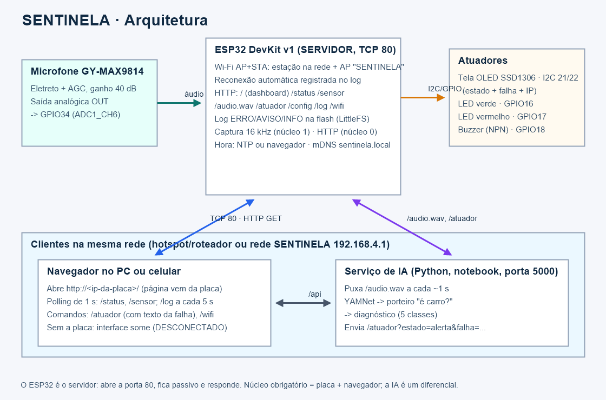

# SENTINELA — Relatório completo do desenvolvimento

Este documento conta tudo o que foi feito no projeto entre **06/11/2026** (primeira intervenção no código) e **09/11/2026** (véspera da apresentação). Ele explica:

- como o sistema estava no início, quando ainda não tinha IA;
- como ele funciona agora, do detalhe elétrico até a visão geral;
- como a inteligência artificial foi treinada;
- quais problemas apareceram no caminho e como foram resolvidos.

Ele foi escrito para ser lido por qualquer pessoa: as seções 1 e 2 não exigem conhecimento técnico. As seções seguintes vão aprofundando. Há um glossário no final.

> Os números de desempenho da IA vêm de `docs/metricas_ia.md`, que é gerado automaticamente pelo treino. O que não pôde ser testado sem a placa física está listado explicitamente na seção 9.

---

## Sumário

1. [O projeto em uma página (para leigos)](#1-o-projeto-em-uma-página-para-leigos)
2. [Uma analogia para explicar a qualquer pessoa](#2-uma-analogia-para-explicar-a-qualquer-pessoa)
3. [Linha do tempo](#3-linha-do-tempo)
4. [Ponto de partida: como o sistema estava antes](#4-ponto-de-partida-como-o-sistema-estava-antes)
5. [Como o sistema funciona agora — do micro ao macro](#5-como-o-sistema-funciona-agora--do-micro-ao-macro)
6. [A inteligência artificial em detalhe](#6-a-inteligência-artificial-em-detalhe)
7. [Problemas encontrados e como foram resolvidos](#7-problemas-encontrados-e-como-foram-resolvidos)
8. [Testes realizados e resultados](#8-testes-realizados-e-resultados)
9. [O que ainda não foi verificado](#9-o-que-ainda-não-foi-verificado)
10. [Limitações honestas e trabalhos futuros](#10-limitações-honestas-e-trabalhos-futuros)
11. [Antes × depois (resumo)](#11-antes--depois-resumo)
12. [Glossário](#12-glossário)

---

## 1. O projeto em uma página (para leigos)

Mecânicos experientes conseguem dizer muita coisa só **ouvindo** um motor. O SENTINELA tenta fazer isso com eletrônica e computação:

1. Um **microfone** fica perto do motor.
2. Uma plaquinha barata, o **ESP32**, transforma o som em números 16 mil vezes por segundo.
3. A própria plaquinha cria uma **rede Wi-Fi** chamada `SENTINELA`. O notebook se conecta a ela, sem precisar de internet.
4. No notebook, uma **página web (dashboard)** mostra o volume do som ao vivo e tem botões para acender **luzes** (LED verde = tudo bem, LED vermelho = alerta) e tocar um **apito** (buzzer).
5. Um programa de **inteligência artificial** no notebook escuta o mesmo som e responde três perguntas:
   - *Tem som suficiente para analisar?*
   - *Isso é mesmo um motor de carro?* (ou é uma pessoa falando, um cachorro, palmas…)
   - *Se é um motor: ele está normal ou tem algum destes problemas: batida de pino, falha de ignição, correia ou tucho/válvula?*
6. Se a IA identificar uma falha com segurança, ela acende o LED vermelho e toca o apito. Ela também mostra um **cartão** com causas prováveis, o que verificar e o nível de urgência.

O sistema **não substitui um mecânico**. É uma ferramenta de **apoio à decisão**, e quando não tem certeza, diz "**inconclusivo**" em vez de chutar.

Exigências da disciplina e como foram atendidas:

| Exigência | Como o SENTINELA atende |
|---|---|
| ESP32 como **servidor** | O ESP32 roda um servidor web na porta 80 e **recebe** pedidos do notebook |
| Pelo menos 1 sensor | Microfone GY-MAX9814 |
| Pelo menos 1 atuador comandado pela rede | LEDs verde/vermelho e buzzer, acionados por `/atuador?estado=...` |
| Consultar leituras pela rede | Rotas `/sensor`, `/status` e `/audio.wav` |
| Mostrar conectado/desconectado e estado | Dashboard com selo CONECTADO/DESCONECTADO e painéis do sensor e dos atuadores |
| Tratar queda do ESP32 | O dashboard percebe em ~3 s e reconecta sozinho |

---

## 2. Uma analogia para explicar a qualquer pessoa

Pense numa **consulta médica com estetoscópio**:

| No consultório | No SENTINELA |
|---|---|
| O estetoscópio encosta no peito | O **microfone** fica perto do motor |
| O som vai pelo tubo até o ouvido | O **ESP32** converte o som em números e os guarda por ~2 segundos |
| O médico tem a própria "linha direta" com o paciente | O ESP32 cria a **própria rede Wi-Fi**, sem depender da rede da faculdade |
| O prontuário na tela | O **dashboard**: volume ao vivo, histórico, estado das luzes |
| O médico, que ouviu milhares de corações durante a formação | A **IA**, que "ouviu" milhares de trechos de motores (normais e com defeito) e de sons que não são motor |
| "Não consigo ouvir direito, vamos repetir" | A resposta "**sinal fraco**" ou "**inconclusivo**" |
| "Isso aí não é o coração, é o seu estômago" | A resposta "**não é motor de carro**" |
| O diagnóstico com recomendações | O **cartão de diagnóstico**: causas prováveis, o que verificar, urgência |
| O alarme do monitor cardíaco | O **LED vermelho** e o **buzzer** |

E o ponto mais importante: **se o médico (a IA) sair da sala, o estetoscópio e o monitor continuam funcionando.** O núcleo do sistema (ESP32 + dashboard + luzes) não depende da IA.

---

## 3. Linha do tempo

| Quando | O que aconteceu | Commit |
|---|---|---|
| 06/11 09:39 | Estado inicial já existente no repositório: estrutura de pastas, firmware com servidor e rotas, dashboard antigo | `9cf83ad`, `7a7e48e` |
| 06/11 (manhã) | **Diagnóstico do repositório** e revisão do firmware: 5 problemas encontrados (seção 4) | — |
| 06/11 10:09 | **Fase 1**: firmware reescrito em 3 arquivos; filtro de DC, taxa exata de 16 kHz e condição de corrida corrigidos; medição de amostras perdidas | `1294b45` |
| 06/11 10:09 | Script automático de testes de aceitação do firmware (`tools/teste_fase1.py`) | `0d720bb` |
| 06/11 10:09 | Documentação da API, decisões e roteiro de testes | `7475b83` |
| 08/11 22:47 | Download dos datasets (kwerimoto, amrrashed) e do modelo YAMNet, com prova de funcionamento offline | `9337584` |
| 08/11 22:51 | **Fase 2**: dashboard novo (JS puro, offline) e simulador do ESP32 | `f738435` |
| 08/11 23:28 | **Fase 3**: IA completa (preparação dos dados, treino, serviço local, gravação). Descoberta dos arquivos corrompidos e de outros 4 problemas de IA (seção 7) | `1b89cf7` |
| 08/11 23:30 | Ajustes visuais para projetor | `3878b27` |
| 08/11 23:37 | **Fase 4/5**: README, explicação do código, diagramas, roteiro de montagem; tag `v1.0-pre-montagem` | `de4cb03` |
| 09/11 09:15 | **Rodada 2 da IA**: novos dados encontrados na web (MyDataSet, ESC-50), 5 classes, modo ao vivo estável, correção de um bug de alerta falso, kit de sons para a demo; tag `v1.1-pre-montagem` | `8364145` |

---

## 4. Ponto de partida: como o sistema estava antes

Quando o trabalho começou, o repositório já tinha a estrutura de pastas, um firmware e um dashboard. **Não havia IA, nem testes automáticos, nem simulador.** O código existente compilava, mas a revisão encontrou problemas importantes.

### 4.1 Firmware original (ESP32)

**O que estava bom e foi aproveitado:** a ideia central já estava certa. Havia um Access Point `SENTINELA`, o servidor HTTP com todas as rotas do contrato e a amostragem por **timer de hardware + tarefa FreeRTOS no núcleo 1** (o método recomendado).

**O que estava errado:**

| # | Problema | Consequência prática |
|---|---|---|
| 1 | **Filtro de DC com "zona morta"**: a média usava conta inteira (`media += (x - media) >> 8`), que para de se ajustar quando a diferença fica abaixo de 256 | O volume medido em **silêncio** saía inflado. Numa simulação, o RMS deu 32 em vez de 8, e no pior caso o erro chega a 255 contagens (nível ~40% em silêncio) |
| 2 | **Taxa de amostragem de 16 129 Hz** (timer a cada 62 µs) em vez de 16 000 Hz | Pequeno erro de afinação do áudio; o modelo de IA exige 16 kHz |
| 3 | **Condição de corrida**: o modo automático mudava os LEDs de dentro da tarefa de áudio enquanto os comandos HTTP mudavam os mesmos LEDs em outra tarefa | Comportamento imprevisível dos atuadores |
| 4 | **Alerta "pisca-pisca"** no modo automático: voltava ao normal na primeira janela abaixo do limiar | O buzzer ligaria e desligaria a cada palavra falada |
| 5 | **Sem medição de estabilidade** (amostras perdidas, jitter) e **sem log de memória** | Impossível provar que a amostragem estava estável com o Wi-Fi ligado |

### 4.2 Dashboard original

O dashboard antigo **não funcionava com o firmware**, e ainda **violava a regra de funcionar offline**:

| Problema | Detalhe |
|---|---|
| Dependia de internet | Carregava o Tailwind CSS de um CDN (`https://cdn.tailwindcss.com`). Na apresentação, sem internet, a página sairia sem estilo |
| Lia um campo inexistente | Procurava `data.sensor` em `/status`, mas o firmware não envia esse campo. O resultado seria sempre "Resposta inválida do sensor" |
| Enviava comandos que o ESP32 rejeita | Os botões mandavam `/atuador?estado=on` e `estado=off`, mas o firmware só aceita `normal`, `alerta`, `off` e `teste`. O "Ligar alerta" receberia erro 400 |
| Sem gráficos, sem histórico, sem IA | Só um número e dois botões |

### 4.3 O que não existia

- Nenhuma inteligência artificial (nem dados, nem modelo, nem serviço).
- Nenhum teste automatizado e nenhum simulador do ESP32 (sem a placa, nada podia ser testado).
- Documentação parcial e desatualizada. Os diagramas estavam em inglês e não mostravam a IA nem o transistor do buzzer.

---

## 5. Como o sistema funciona agora — do micro ao macro

Esta seção acompanha **a viagem de um som**: da vibração do ar até a luz vermelha acendendo.

### 5.1 Nível 1 — O som vira eletricidade (microfone GY-MAX9814)

- O som é **ar vibrando**. Dentro do módulo há um microfone de eletreto, uma membrana que vibra e gera um sinal elétrico minúsculo.
- O chip **MAX9814** amplifica esse sinal (ganho fixo de 40 dB, porque o pino GAIN está ligado ao VDD) e tem **AGC** (controle automático de ganho), que reduz o ganho quando o som fica muito alto, para não distorcer.
- A saída OUT é uma **tensão que sobe e desce** acompanhando o som, oscilando ao redor de ~1,25 V. Ela vai para o pino **GPIO34** do ESP32.
- Por que o GPIO34? Ele pertence ao **ADC1**, o conversor que continua funcionando com o Wi-Fi ligado. O ADC2 é usado pelo rádio e não pode ser usado junto.

### 5.2 Nível 2 — A eletricidade vira números (amostragem no ESP32)

Arquivo: `src/esp32/esp32_server/captura_audio.cpp`.

1. **O relógio.** Um **timer de hardware** é configurado para "bater" exatamente **16 000 vezes por segundo**. O relógio interno de 80 MHz é dividido por 40 (dá 2 MHz), e o alarme dispara a cada 125 tiques, ou seja, a cada 62,5 µs.
2. **O despertador.** A cada batida, uma interrupção mínima apenas "acorda" uma tarefa dedicada. A leitura do ADC não pode ser feita dentro da interrupção, porque usa travas internas.
3. **A leitura.** A tarefa (núcleo 1, prioridade alta) lê o conversor: um número de **0 a 4095** (12 bits) proporcional à tensão.
4. **Tirar o "meio".** O sinal fica em torno de ~1,25 V, que é o **nível DC**, e não interessa. Uma média móvel lenta (em `float`, sem zona morta) estima esse nível e ele é subtraído. Sobra só a vibração, positiva e negativa ao redor de zero.
5. **Formato de áudio padrão.** O valor é multiplicado por 16, para ocupar a faixa de 16 bits do formato PCM (-32768 a +32767), e gravado num **buffer circular** de 32 768 posições (64 KB, ~2 segundos). "Circular" quer dizer que, quando enche, o mais antigo é sobrescrito, como uma esteira.
6. **Resumo a cada 250 ms.** A cada 4000 amostras, a tarefa calcula:
   - o **RMS** (o "volume médio" de verdade);
   - o **pico**;
   - um **nível de 0 a 100** (escala relativa, não decibéis);
   - se houve **saturação** (*clipping*);
   - os valores **mínimo e máximo** brutos (para detectar leituras zeradas).
7. **Medindo a si mesma.** A tarefa conta **quantas batidas perdeu** (se atrasou) e o **maior intervalo** entre duas amostras. Assim a estabilidade é **medida**, não suposta.

O Wi-Fi roda no **núcleo 0** do processador; a captura roda no **núcleo 1**. Por isso a rede não atrapalha a amostragem.

### 5.3 Nível 3 — O ESP32 como servidor (rede e comandos)

Arquivos: `esp32_server.ino` (rede) e `atuadores.cpp` (luzes e apito).

- **Rede própria.** Ao ligar, o ESP32 cria o Wi-Fi `SENTINELA` (senha `sentinela123`) e assume o endereço `192.168.4.1`. Redes de faculdade costumam isolar os aparelhos; com rede própria, isso não é problema, e nada precisa de internet.
- **Servidor HTTP** na porta 80, com **rotas** (endereços) que respondem em **JSON** (texto estruturado):

| Rota | Para que serve |
|---|---|
| `/status` | Saúde da placa: tempo ligada, taxa real de amostragem, memória livre, amostras perdidas, estado das luzes |
| `/sensor` | Volume dos últimos 250 ms (RMS, pico, nível, saturação) |
| `/audio.wav?ms=1000` | O áudio dos últimos 0,2 a 2 s, como arquivo WAV (é isso que a IA ouve) |
| `/atuador?estado=normal\|alerta\|off\|teste` | Comanda as luzes e o apito |
| `/config?modo=auto&limiar=45` | Modo automático: o próprio ESP32 acende o alerta quando o volume passa do limiar (funciona sem IA) |

- **Segurança contra erros:** parâmetros inválidos recebem **erro 400** com explicação, e endereços inexistentes recebem **404**. Todas as respostas liberam o acesso de outras páginas (CORS) e proíbem cache.
- **Envio do áudio sem estourar a memória:** o WAV é montado na hora, com cabeçalho de 44 bytes e o tamanho exato informado, e enviado em **blocos de 512 bytes**, lidos direto do buffer circular.
- **Atuadores:**
  - `normal` → LED verde (GPIO16);
  - `alerta` → LED vermelho (GPIO17) + buzzer (GPIO18, através de um transistor NPN, porque o buzzer de 5 V precisa de mais corrente do que o pino fornece);
  - `teste` → sequência de 2 s (pisca verde/vermelho, apita) e volta ao estado anterior.
  - O **LED azul da própria placa (GPIO2)** acompanha o alerta, o que permite testar tudo sem nenhuma peça externa.
- **Modo automático (plano B sem IA):** acende o alerta depois de 3 janelas seguidas acima do limiar (~0,75 s) e só apaga depois de 8 abaixo (~2 s). Essa **histerese** evita o pisca-pisca.
- **Diário de bordo:** a cada 10 s, a placa escreve na porta serial uma linha `[saude]` com memória, taxa, perdas e volume, base do teste de 30 minutos.

### 5.4 Nível 4 — O dashboard (o que o usuário vê)

Arquivos: `src/client/index.html`, `app.js`, `style.css`. Abre por **duplo clique**, sem instalar nada e sem internet.

- **Laço do ESP32 (a cada 1 s):** pede `/status` e, em seguida, `/sensor`, um depois do outro, porque o servidor do ESP32 atende um cliente por vez. Cada pedido tem **prazo de 2 s**. Com **duas falhas seguidas**, o selo vira **DESCONECTADO** em vermelho e os botões são bloqueados. O laço nunca para, então, quando a placa volta, ele **reconecta sozinho**.
- **Painéis:**
  - volume ao vivo com barra colorida e **gráfico dos últimos 60 s**;
  - estado dos atuadores (círculos que "acendem") e botões Normal / Alerta / Buzzer / Teste / Desligar;
  - modo automático;
  - forma de onda e espectro de frequências do último segundo de áudio (calculado no próprio navegador por uma FFT);
  - dados de saúde da placa.
- **Laço da IA (a cada 1 s):** pede `/api/resultado` ao serviço de IA. Se ele estiver desligado, **só o painel da IA** fica indisponível ("IA: OFFLINE"); o resto continua funcionando.
- **Painel da IA:**
  - botão grande **DIAGNOSTICAR (5 s)** com barra de progresso;
  - ranking com a **probabilidade estimada pelo modelo** para cada classe;
  - cartão de diagnóstico com causas, o que verificar e urgência;
  - resultado ao vivo, **decisão estabilizada** e histórico;
  - opções "modo demo (animais)", "IA comanda os LEDs" e "Calibrar silêncio".
- Pensado para **projetor**: fundo escuro, letras grandes e estados sempre em **texto e cor**.

### 5.5 Nível 5 — O serviço de IA (o "ouvido treinado")

Arquivos em `src/ai/`. Roda no notebook, em `http://localhost:5000`.

**Cada análise segue três perguntas em ordem** (arquivo `analise.py`):

```text
          áudio do ESP32
               │
   1. Tem som?  ── não ──► "Silêncio / sinal fraco"
               │ sim
               ▼
   YAMNet (rede neural do Google): transforma cada 0,96 s de som
   em 1024 números (um "resumo") + 521 probabilidades de tipos de som
               │
   2. É motor de carro?  ── não ──► "Não é motor de carro"
      (porteiro treinado + veto do YAMNet para fala, música, animais...)
               │ sim
               ▼
   3. Qual o estado? ─► normal · batida de pino · falha de ignição · correia · tucho
               │
     confiança ≥ 60%? ── não ──► "Inconclusivo" (repita mais perto)
               │ sim
               ▼
   Cartão de diagnóstico + comando ao ESP32 (LED vermelho/apito ou LED verde)
```

**Dois modos de uso:**

1. **Botão DIAGNOSTICAR (5 s).**
   1. O serviço baixa 1 s de áudio por segundo, cinco vezes.
   2. Descarta os segundos silenciosos e **junta o restante** (~5 s).
   3. Analisa tudo de uma vez e faz a média das probabilidades.
   4. Se uma falha passar de 60% de confiança, comanda o **alerta**; se for "normal", o **LED verde**.
   5. Se ficar abaixo de 60%, responde **inconclusivo** e não finge certeza.
2. **Modo ao vivo (a cada ~1 s).**
   1. O serviço mantém uma **memória dos últimos 5 s** e reanalisa a cada segundo.
   2. A **decisão estabilizada** muda só quando **3 dos últimos 5** votos confiantes concordam.
   3. Silêncio e "não é carro" não votam.
   4. Se a opção "IA comanda os LEDs" estiver ligada, ela envia o comando ao ESP32 **apenas quando a decisão muda**.

**Calibração:** o ruído de fundo real do microfone só é conhecido na placa. O botão "Calibrar silêncio" mede 3 s de silêncio e ajusta o limiar de "sinal fraco" automaticamente.

### 5.6 Nível 6 — A visão geral (macro)



```text
 MOTOR ))) som
      │
 [MAX9814]  microfone + amplificador  →  tensão elétrica
      │ GPIO34
 [ESP32]  16 000 leituras/s → buffer de 2 s → servidor web (Wi-Fi próprio "SENTINELA")
      │                                  ▲
      │ HTTP (rede local, sem internet)  │ comandos /atuador
      ▼                                  │
 [NOTEBOOK]                              │
   ├─ Dashboard (navegador): mostra tudo, botões manuais ──────────┤
   └─ Serviço de IA (Python): ouve /audio.wav, decide, comanda ────┘
      │
 [LEDs + BUZZER]  verde = normal · vermelho + apito = alerta · azul da placa = espelho do alerta
```

**Princípio de projeto:** cada camada funciona sem a de cima. O ESP32 funciona sem dashboard (é possível usar `curl`). O dashboard funciona sem a IA. E até o alerta tem um plano B sem IA (modo automático por volume).

---

## 6. A inteligência artificial em detalhe

### 6.1 Conceitos, explicados de forma simples

- **Aprendizado de máquina:** em vez de programar regras ("se o som tiver tal frequência, é batida de pino"), mostramos milhares de **exemplos rotulados** ao computador, e ele aprende sozinho a separá-los.
- **YAMNet:** uma rede neural do Google já treinada com ~2 milhões de vídeos do YouTube para reconhecer **521 tipos de som** (fala, cachorro, motor, música…). Usamos o YAMNet **como ouvido**: ele transforma cada pedaço de 0,96 s de áudio em **1024 números**, o **embedding**, uma espécie de "impressão digital" do som. Sons parecidos geram impressões digitais parecidas.
- **Transfer learning (aprendizado por transferência):** temos poucos dados de motores com defeito, poucos demais para treinar uma rede neural do zero. Então aproveitamos o que o YAMNet já sabe sobre sons e treinamos **só uma camada final simples** em cima.
- **Regressão logística:** esse classificador final. Ele aprende **pesos** que, aplicados às 1024 características, dão uma **probabilidade** para cada classe. Treina em segundos, é pequeno (~67 KB, junto com o porteiro) e fácil de explicar.
- **Treino, validação e teste:**
  - **treino**: os exemplos com que o modelo aprende;
  - **validação**: usada para escolher ajustes (como "quão rígido" é o modelo);
  - **teste**: só olhado no final, para medir com honestidade.
  - É como estudar com exercícios, testar-se com um simulado e só então fazer a prova.

### 6.2 Os dados

| Fonte | Origem | O que foi usado | Observação |
|---|---|---|---|
| **kwerimoto** | Hugging Face | `normal` (351), `falha_batida_pino` (608), `falha_ignicao` (108) | Base principal. Junta 3 fontes; parte do knock e do normal é **sintética** (Revix). Inclui 38 knocks **reais** do AudioSet separados só para teste |
| **MyDataSet** | Hugging Face | `falha_correia` (59), `falha_tucho` (68) | Gravações de **celular** em vários carros (domínio parecido com o nosso). As partes normal/misfire já estavam no kwerimoto e **não** foram reutilizadas |
| **ESC-50** | GitHub | ~1755 trechos como `nao_carro` | Sons de ambiente: palmas, risada, teclado, batida em porta, animais, chuva… Categorias com motor foram excluídas |
| **amrrashed** | GitHub | Falhas mecânicas variadas (só como exemplos de "é carro") e animais/sirenes/tiros como `nao_carro` | Os arquivos segmentados estavam **corrompidos** (seção 7). Usamos as gravações originais |
| **Ruído sintético** | Gerado pelo próprio código | 48 trechos de ruído branco/rosa/marrom e zumbido de 60 Hz como `nao_carro` | Para um chiado nunca virar "carro com falha" |

Total na versão final: **3156 trechos** (até 10 s cada).

### 6.3 Preparação dos dados (`prepare_dataset.py`)

1. **Mapeamento:** o arquivo `fontes.json` diz qual pasta vira qual classe. Isso permite trocar dados sem mexer no código. Datasets novos (por exemplo, do Kaggle) são mapeados por palavras-chave (`knock`, `misfire`, `healthy`…).
2. **Padronização:** todo áudio vira **16 kHz, mono**, em trechos de **até 10 s**. Trechos curtos demais ou mudos são descartados.
3. **Normalização:** todo trecho é levado ao mesmo volume médio (RMS 0,1). O serviço ao vivo faz **exatamente a mesma conta**; se fossem diferentes, o modelo veria ao vivo um áudio diferente do que viu no treino.
4. **Filtro de corrupção:** trechos que são "ruído branco em volume máximo" são descartados automaticamente (seção 7.3).
5. **Separação por gravação:** vários trechos saem da mesma gravação. Se um ficasse no treino e outro no teste, seria como **o aluno ver a prova antes**. Por isso a divisão 70% treino / 15% validação / 15% teste é feita **por gravação (grupo)**, nunca por trecho.

### 6.4 Treinamento (`train.py`)

1. **Impressões digitais:** cada trecho passa pelo YAMNet e gera um embedding a cada 0,48 s. Elas ficam guardadas em cache (o cálculo leva ~1–2 minutos na primeira vez).
2. **Aumento de dados:** cada trecho de treino ganha uma **cópia "estragada" de propósito**, como se tivesse passado pelo **alto-falante do celular → MAX9814 → conversor de 12 bits do ESP32**:
   - faixa de frequência cortada (graves abaixo de 100–300 Hz e agudos acima de 4–7 kHz);
   - ruído de fundo;
   - às vezes saturação e quantização de 12 bits.
   
   Isso ensina o modelo a reconhecer o som mesmo "de qualidade pior".
3. **Dois classificadores:**
   - **Porteiro:** `carro` × `nao_carro`.
   - **Diagnóstico:** `normal`, `falha_batida_pino`, `falha_ignicao`, `falha_correia`, `falha_tucho`.
4. **Pesos balanceados:** cada classe pesa igual (há 600 knocks e só 59 correias). Dentro de cada classe, cada fonte pesa pela **raiz quadrada** do seu tamanho, para que o modelo não aprenda "qual dataset é este" em vez de "que som é este".
5. **Escolha do ajuste (C):** três valores são testados na **validação**, e o melhor (pela F1-macro) é escolhido.
6. **Modelo final:** treinado com treino + validação e avaliado **uma única vez** no teste.
7. **Limiar de confiança:** escolhido na validação, simulando o botão de 5 s: o menor limiar que acerta ≥ 90% respondendo ≥ 60% das vezes. O resultado foi **60%**.
8. **Relatório automático:** `docs/metricas_ia.md` reúne:
   - acertos por classe e **por fonte**;
   - matriz de confusão;
   - curva do limiar;
   - **teste de robustez** com áudio degradado (parâmetros fixos, diferentes dos do treino);
   - teste com **knock real** nunca visto.

### 6.5 Resultados finais (conjunto de teste)

| Pergunta | Resultado |
|---|---|
| É carro? (porteiro + veto) | **93%** de acerto; rejeita ~94% dos sons de sala do ESC-50 |
| Diagnóstico (5 classes, por trecho) | **81,7%** de acerto (F1-macro 0,868) |
| Botão DIAGNOSTICAR (5 s) | **81,1%** de acerto. Com o limiar de 60%: responde **76%** das vezes com **89%** de acerto; o resto é "inconclusivo" |
| Normal × falha (o que acende o alerta) | **Precisão 94%**: quando diz "falha", acerta 94% das vezes. **Revocação 83%**: pega 83% das falhas |
| Knock **real** (AudioSet), nunca visto | **89,5%** reconhecido como batida de pino |
| Áudio degradado (simulando celular + microfone) | **72,5%** de acerto; porteiro aceita 82% como carro |

A maior confusão restante é **batida de pino × normal**: alguns knocks leves soam como motor normal. Correia e tucho tiveram 89–100% de acerto, mas com poucos exemplos de teste (9 e 10), e o próprio dataset não diz quais gravações são do mesmo carro. Esses números devem ser lidos como **otimistas**.

### 6.6 Evolução do modelo (por que cada versão mudou)

| Versão | O que mudou | Resultado principal | Por que não ficou |
|---|---|---|---|
| v0 | Primeiro treino: 4 classes, com os arquivos segmentados do amrrashed | Diagnóstico 83,5%; `falha_outros` com 100% | **Falsa**: os arquivos eram ruído branco, e o modelo aprendeu "ruído = falha". O porteiro rejeitava todo carro do amrrashed |
| v0b | Pesos por fonte | Diagnóstico 85,2% | Mesmo problema dos dados corrompidos |
| v1a | Dados originais íntegros + ruído sintético | Porteiro 96%; `falha_outros` com **0%** | Falhas mecânicas variadas demais para tão poucos dados |
| v1 | 3 classes, pesos pela raiz, só quadros completos do YAMNet | Botão 5 s 78,7%; ponta a ponta 17 de 18 | Base sólida (tag `v1.0`) |
| **v2** | + correia, tucho, ESC-50, aumento de dados imitando a captura, modo ao vivo com memória de 5 s | Botão 5 s **81,1%**; precisão do alerta **94%**; kit da demo 24 de 24 | **Versão atual** (tag `v1.1`) |

---

## 7. Problemas encontrados e como foram resolvidos

Esta é talvez a parte mais importante para a defesa. Mostra que os resultados foram **questionados**, não aceitos de primeira.

### 7.1 Firmware

1. **Filtro de DC com zona morta** → trocado por média móvel em `float`. Na simulação, o volume em silêncio passou de RMS 32 (errado) para 8 (correto).
2. **Taxa de 16 129 Hz** → divisor 40 e alarme 125 dão **16 000 Hz exatos**.
3. **Condição de corrida nos LEDs** → só a tarefa principal (`loop`) mexe nos atuadores.
4. **Alerta pisca-pisca no modo automático** → histerese (3 janelas para ligar, 8 para desligar).
5. **Estabilidade não medida** → contagem de amostras perdidas, maior intervalo e log de saúde a cada 10 s.

### 7.2 Ambiente e ferramentas (Windows)

6. **Arquivos chamados `...`** num repositório do GitHub: nome proibido no Windows, que travava o download. Foram extraídos todos os outros 1079 arquivos, pulando só esses 52 (que nem tinham áudio).
7. **Acentos quebrando scripts:** o console do Windows usa uma codificação antiga (cp1252), e o PowerShell 5.1 lê arquivos sem BOM como ANSI (um "−" Unicode chegou a quebrar a sintaxe). Os scripts passaram a forçar UTF-8.

### 7.3 Inteligência artificial

8. **Dados corrompidos (o achado mais importante).**
   - **Sintoma:** a v0 parecia ótima, com 100% numa classe. Mas o YAMNet classificava gravações de **gato** como "chuva/spray".
   - **Investigação:** medimos a **autocorrelação** (o quanto cada amostra se parece com a vizinha). Áudio real dá 0,8–0,97; esses arquivos davam **0,00**, com volume no máximo. Isso é **ruído branco**, ou seja, os arquivos estavam estragados na origem.
   - **Solução:** usar as gravações originais e criar um **filtro automático** que descarta esse padrão em qualquer dataset futuro.
9. **Viés de fonte:** todos os exemplos de "não carro" vinham do mesmo dataset, então o porteiro aprendeu a reconhecer **o dataset**, não o som. Resolvido com dados íntegros, mais fontes de negativos (ESC-50, ruído sintético) e pesos por fonte. A tabela "acerto por fonte" em `metricas_ia.md` existe para vigiar isso.
10. **Peso desproporcional:** com peso igual por fonte, **1 único trecho** de uma fonte valia o mesmo que 76 de outra. Trocado por peso proporcional à raiz quadrada do tamanho.
11. **Classe sem dados suficientes:** "outras falhas mecânicas" (~4 min de 29 problemas diferentes) teve **0%** de acerto no teste. Decisão: **não diagnosticar** o que não sabemos diagnosticar. Essas gravações ficaram só como exemplos de "é carro".
12. **Quadros "meio vazios" do YAMNet:** ao receber 1 s de áudio, o YAMNet completa o final com zeros e cria um segundo quadro **metade silêncio**, que quase nunca aparece no treino. Ao vivo, isso derrubava a confiança (motor normal saía "inconclusivo" com 42–47%). Solução: usar **só quadros completos** e analisar o diagnóstico de 5 s **de uma vez**. Depois disso, 17 de 18 testes de ponta a ponta acertaram.
13. **Oscilação no modo ao vivo:** analisando só 1,5 s por vez, o painel alternava entre "batida", "normal" e "fala", e a decisão chegou a ficar em NORMAL tocando knock. Solução: **memória de 5 s**. Depois, 12 de 12 leituras corretas em cada classe.
14. **Bug do alerta antigo:** com "IA comanda os LEDs" ligada, uma decisão "alerta" guardada de minutos antes era reenviada, e o LED vermelho acendia **em silêncio** (59 de 60 leituras). Solução: ligar a opção ou trocar de ESP32 **zera** a decisão. Reteste no mesmo cenário: **0 de 60**.
15. **Kit de demonstração frágil:** a primeira versão validava só os 5 s iniciais de cada som, e o tucho deu "inconclusivo" em outras posições do áudio. Agora cada som é validado **em qualquer janela de 5 s**: 24 de 24.
16. **Mensagem contraditória** "não é motor de carro (veículo)" → o nome do som só aparece quando o YAMNet o reconheceu claramente.

---

## 8. Testes realizados e resultados

| Teste | Como | Resultado |
|---|---|---|
| Compilação do firmware (do zero, todos os avisos ligados) | `arduino-cli compile --clean --warnings all` | **0 avisos**; 772 497 bytes (58% da flash); 216 KB de RAM livre |
| Compilação do teste do microfone | idem | OK (268 769 bytes) |
| Rotas, códigos de erro e WAV | `tools/teste_fase1.py rotas` contra o simulador | **42 de 42** verificações OK |
| Áudio contínuo com downloads em loop | `teste_fase1.py critico` contra o simulador | OK |
| Qualidade do código Python e JS | `pyflakes`, `node --check` | Sem problemas |
| YAMNet funciona sem internet | Verificação com toda conexão de rede bloqueada | OK |
| Dashboard num navegador real | Edge em modo headless: conectado, desconectado, painel de IA, cartão de diagnóstico | OK (screenshots em `docs/screenshots/`) |
| Botão DIAGNOSTICAR com trechos de teste **sorteados** | Simulador tocando 6 trechos de cada classe | **18 de 21** certos; os outros 3 deram "inconclusivo" (nenhum erro afirmado) |
| Kit de sons da demo | Simulador, 4 diagnósticos por classe | **24 de 24** |
| Modo ao vivo | 12 leituras por classe | **12 de 12** em todas as classes |
| Silêncio com a IA comandando os LEDs (critério de aceitação 4) | 60 s, inclusive logo após um alerta | **0 alertas** |
| Animais, tom puro, ruído | Simulador | "Não é carro" em todos |
| Recuperação da IA quando o ESP32 some | Endereço trocado para um ESP32 inexistente e de volta | Mostrou "ESP32 sem resposta" e voltou sozinha |
| Atalho `iniciar_ia.bat` | Executado (sem abrir o navegador) | Subiu o serviço com o endereço informado |

---

## 9. O que ainda não foi verificado

Tudo abaixo depende da **placa física** e está nos roteiros [FASE_1_TESTES.md](FASE_1_TESTES.md) e [MONTAGEM_SEGUNDA.md](MONTAGEM_SEGUNDA.md):

- o firmware novo **rodando na placa** (até aqui ele foi compilado, não executado);
- a amostragem **estável com o Wi-Fi ligado**, que é o teste crítico (taxa real, amostras perdidas, leituras zeradas);
- 30 minutos ligada sem reiniciar;
- a ligação dos LEDs e do buzzer com transistor;
- o funcionamento no power bank;
- a IA com **som real** passando por alto-falante e MAX9814. É o maior risco: o áudio real é diferente dos datasets. Mitigações já prontas: botão "Calibrar silêncio", treino com áudio degradado e o `record.py` para gravar exemplos pela própria placa e retreinar em ~10 minutos.

---

## 10. Limitações honestas e trabalhos futuros

**Limitações:**
- Os dados vêm da internet, e parte é sintética. Nenhum foi gravado com o MAX9814.
- `falha_ignicao` vem praticamente de uma fonte só. Correia e tucho têm poucos exemplos de teste, e seus números tendem a ser otimistas.
- Batida de pino e motor normal ainda se confundem em ~20–30% dos casos difíceis.
- O porteiro não tem exemplos de **fala** e **música** nos dados de treino: depende do veto do YAMNet.
- O modelo diz *o que* parece estar errado, mas não *onde*: há um microfone só, e não há localização da falha.

**Trabalhos futuros:**
- gravar um dataset próprio com o SENTINELA em carros reais;
- mais classes (rolamento, escapamento, freio) quando houver dados;
- vários microfones para localizar a origem do ruído;
- modelo rodando dentro do próprio ESP32 (TinyML);
- display OLED;
- aplicativo móvel.

---

## 11. Antes × depois (resumo)

| Aspecto | Antes (06/11, primeira revisão) | Agora (09/11) |
|---|---|---|
| Firmware | 1 arquivo com 5 problemas (DC, taxa, corrida, pisca-pisca, sem medição) | 3 arquivos, um por responsabilidade; problemas corrigidos; estabilidade medida; 0 avisos de compilação |
| Taxa de amostragem | 16 129 Hz, sem medição | 16 000 Hz exatos, com taxa real, perdas e jitter medidos |
| Dashboard | Dependia de internet; lia campo inexistente; enviava comandos inválidos | Offline, compatível com a API, gráficos, detecção de queda e reconexão, painel de IA |
| IA | Inexistente | Porteiro "é carro?" + diagnóstico em 5 classes + "inconclusivo" + modo ao vivo estável |
| Dados | Nenhum | 5 fontes, 3156 trechos, divisão por gravação, filtro de corrupção |
| Testes | Nenhum | Roteiro automático (42 verificações), simulador do ESP32, testes de ponta a ponta |
| Sem a placa | Nada podia ser testado | Simulador completo, inclusive tocando áudio real |
| Documentação | README parcial, diagramas em inglês e desatualizados | README completo, API, decisões, métricas, explicação do código, montagem, este relatório |

---

## 12. Glossário

| Termo | Significado simples |
|---|---|
| **ADC** | Conversor analógico-digital: transforma uma tensão elétrica num número |
| **Amostragem (16 kHz)** | Medir o som 16 000 vezes por segundo |
| **Access Point (AP)** | Quando o aparelho cria a própria rede Wi-Fi, como um roteador |
| **AGC** | Controle automático de ganho: o microfone "abaixa o volume" sozinho quando o som é alto |
| **API / rota** | Endereço que o servidor entende, como `/sensor`; pedir esse endereço é como fazer uma pergunta ao ESP32 |
| **Buffer circular** | Memória que guarda os últimos ~2 s e vai sobrescrevendo o mais antigo, como uma esteira |
| **CORS** | Permissão para uma página web falar com um servidor de outro endereço |
| **DC (nível contínuo)** | A parte "parada" do sinal (o meio da onda), que não carrega som |
| **Embedding** | A "impressão digital" de um som: 1024 números que resumem como ele soa |
| **F1 / F1-macro** | Nota que equilibra acertos e esquecimentos; a "macro" dá peso igual a todas as classes |
| **FreeRTOS / tarefa** | Sistema que deixa o ESP32 fazer várias coisas "ao mesmo tempo" (captura, rede…) |
| **HTTP / JSON** | O "idioma" da web / um formato de texto organizado para trocar dados |
| **Histerese** | Exigir mais evidência para mudar de estado, o que evita ficar trocando a toda hora |
| **Inconclusivo** | A IA não teve confiança suficiente (< 60%) e prefere não afirmar |
| **Precisão** | De tudo que a IA chamou de falha, quanto era falha mesmo |
| **Revocação** | De todas as falhas reais, quantas a IA pegou |
| **Regressão logística** | Classificador simples que transforma características em probabilidades |
| **RMS** | Volume médio "de verdade" de um trecho de som |
| **Transfer learning** | Reaproveitar um modelo já treinado (YAMNet) e treinar só a parte final |
| **Treino / validação / teste** | Estudar / fazer simulado / fazer a prova |
| **Vazamento (data leakage)** | Quando o modelo "vê a prova antes", por exemplo trechos da mesma gravação no treino e no teste |
| **YAMNet** | Rede neural do Google que reconhece 521 tipos de som |

---

*Documentos relacionados:*
- [README](../README.md)
- [API](API.md)
- [Decisões técnicas](DECISOES.md)
- [Métricas da IA](metricas_ia.md)
- [Datasets](DATASETS.md)
- [Explicação do código](EXPLICACAO_CODIGO.md)
- [Montagem de segunda](MONTAGEM_SEGUNDA.md)
- [Roteiro de testes da Fase 1](FASE_1_TESTES.md)
