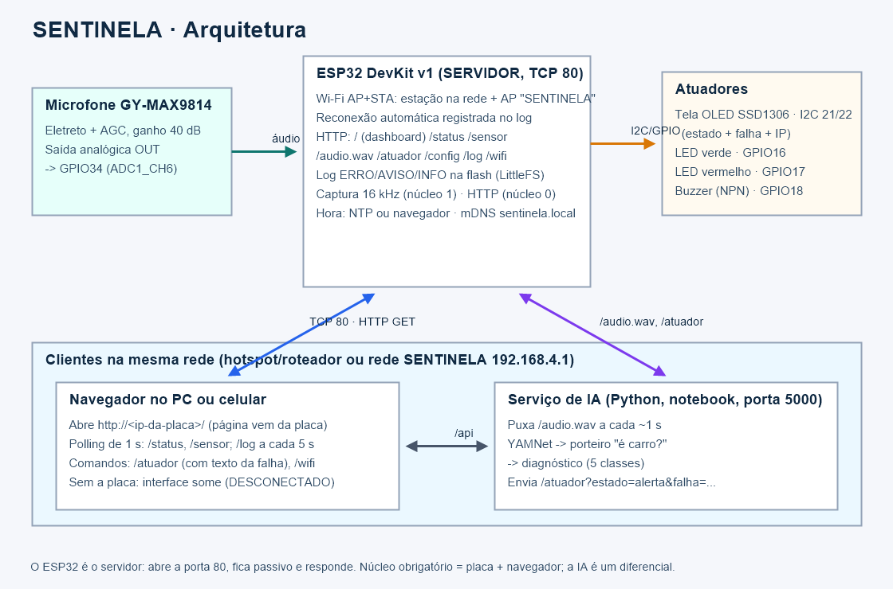
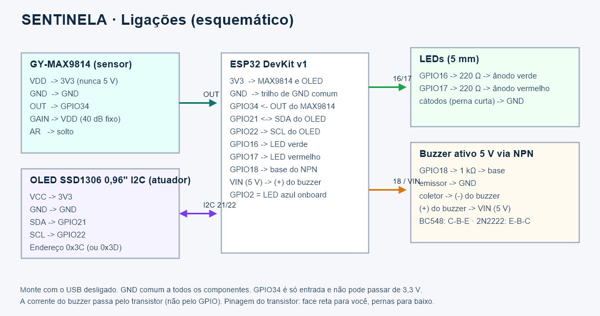

<!--
  Relatório do TDE no formato da ABNT (NBR 14724 – estrutura; NBR 6023 – referências;
  NBR 10520 – citações). Este arquivo é o CONTEÚDO. Para gerar o .docx já formatado
  (margens 3/2 cm, Times New Roman 12, espaçamento 1,5, títulos numerados):
      .venv\Scripts\python tools\gerar_relatorio_docx.py
  Itens entre colchetes [ ] devem ser preenchidos pela equipe.
-->

# CAPA

PONTIFÍCIA UNIVERSIDADE CATÓLICA DO PARANÁ
ESCOLA POLITÉCNICA
ENGENHARIA DE SOFTWARE

LEONARDO FARIAS RIBEIRO
LEONARDO SILVA SOBRINHO
NATHAN BANACH

**SENTINELA: SISTEMA CIBERFÍSICO DE DIAGNÓSTICO ACÚSTICO AUTOMOTIVO COM SERVIDOR HTTP EMBARCADO EM ESP32**

CURITIBA
2026

# FOLHA DE ROSTO

LEONARDO FARIAS RIBEIRO — RA [RA]
LEONARDO SILVA SOBRINHO — RA [RA]
NATHAN BANACH — RA [RA]

**SENTINELA: SISTEMA CIBERFÍSICO DE DIAGNÓSTICO ACÚSTICO AUTOMOTIVO COM SERVIDOR HTTP EMBARCADO EM ESP32**

Trabalho Discente Efetivo apresentado à disciplina de Conectividade em Sistemas Ciberfísicos do curso de Engenharia de Software da Escola Politécnica da Pontifícia Universidade Católica do Paraná.

Professor: Fábio Bettio.

CURITIBA
2026

# RESUMO

Este trabalho apresenta o SENTINELA, um sistema ciberfísico que capta o som de um motor automotivo e o disponibiliza em rede para apoiar o diagnóstico de falhas. Um microfone de eletreto com amplificador e controle automático de ganho (GY-MAX9814) é amostrado a 16 kHz por um ESP32, que atua como servidor HTTP na porta TCP 80. A placa conecta-se a uma rede Wi-Fi como estação, reconecta-se automaticamente após quedas e mantém um ponto de acesso próprio como reserva. Clientes da rede (navegador em computador ou celular, ferramentas de linha de comando e um serviço local de inteligência artificial) consultam as leituras do sensor, recebem trechos de áudio em formato WAV, enviam comandos aos atuadores — uma tela OLED SSD1306, LEDs e um buzzer — e leem um log persistente em memória flash, com ocorrências classificadas como ERRO, AVISO ou INFO e marcadas com data e hora. A própria interface web é servida pelo ESP32. Um serviço opcional em Python usa o modelo YAMNet e um classificador de regressão logística para estimar se o som é de um motor e qual a falha provável, enviando o resultado à tela da placa. A validação incluiu testes de conectividade (ping e ARP), de acesso à porta do servidor, de comunicação cliente-servidor por socket TCP e por HTTP, e de acionamento do sensor e dos atuadores via rede, com evidências registradas no repositório.

**Palavras-chave:** sistemas ciberfísicos; ESP32; servidor HTTP; TCP/IP; diagnóstico acústico.

# 1 INTRODUÇÃO

Ruídos anormais são, muitas vezes, o primeiro sintoma de uma falha mecânica em um motor: a detonação ("batida de pino"), a falha de ignição, o chiado de uma correia gasta ou o "tec-tec" de tuchos e balancins. Identificar esses sons exige experiência, e o motorista comum raramente sabe descrevê-los a um mecânico.

O SENTINELA propõe um sistema ciberfísico simples para esse problema: um microfone próximo ao motor, ligado a um microcontrolador ESP32 conectado à rede, que disponibiliza o som e as medições a qualquer cliente da rede e sinaliza o resultado em atuadores físicos. O foco do trabalho, conforme a disciplina, é a conectividade: o ESP32 implementa o papel de **servidor** em uma arquitetura cliente-servidor sobre a pilha TCP/IP.

## 1.1 Objetivo geral

Desenvolver, implementar e validar um sistema conectado em rede IP no qual o ESP32 funcione como servidor HTTP, permitindo que clientes consultem os dados de um sensor de áudio, acionem atuadores e acessem o log do sistema.

## 1.2 Objetivos específicos

a) amostrar o microfone a 16 kHz de forma estável, mesmo com o Wi-Fi ativo;
b) implementar um servidor HTTP embarcado com rotas de consulta e de comando, incluindo a própria interface web;
c) conectar a placa a uma rede Wi-Fi, com reconexão automática e registro de data e hora das quedas;
d) manter um log persistente em memória flash com níveis ERRO, AVISO e INFO;
e) acionar uma tela OLED que exiba o estado atual e a falha indicada pela rede;
f) validar o sistema com testes de conectividade, de porta, de comunicação cliente-servidor e de sensor e atuador, com evidências.

## 1.3 Organização do documento

O capítulo 2 apresenta a fundamentação teórica e os projetos semelhantes usados como referência; o capítulo 3, a arquitetura; o capítulo 4, o desenvolvimento do hardware e do software; o capítulo 5, os testes e as evidências; o capítulo 6, os resultados; e o capítulo 7, as conclusões.

# 2 FUNDAMENTAÇÃO TEÓRICA

## 2.1 Sistemas ciberfísicos

Sistemas ciberfísicos (CPS, do inglês *cyber-physical systems*) integram computação, comunicação e processos físicos: computadores embarcados e redes monitoram e controlam processos físicos, normalmente em laços de realimentação nos quais os processos físicos afetam a computação e vice-versa (LEE; SESHIA, 2017). Rajkumar et al. (2010) destacam a rede como elemento central desses sistemas, que passam a ser observados e comandados à distância.

No SENTINELA, o processo físico é o som do motor; o sensor é o microfone; a computação ocorre no ESP32 (amostragem, métricas, servidor) e no serviço de IA; e o laço se fecha nos atuadores (tela, LEDs e buzzer), comandados pela rede.

## 2.2 Modelo OSI e modelo TCP/IP

O modelo de referência OSI organiza a comunicação em sete camadas: física, enlace, rede, transporte, sessão, apresentação e aplicação (INTERNATIONAL ORGANIZATION FOR STANDARDIZATION, 1994). O modelo TCP/IP, usado na Internet, agrupa essas funções em quatro ou cinco camadas — enlace (com a física), rede (IP), transporte (TCP e UDP) e aplicação — e é o modelo efetivamente implementado nos dispositivos (KUROSE; ROSS, 2021; TANENBAUM; FEAMSTER; WETHERALL, 2021).

O Quadro 1 mostra como cada camada aparece no SENTINELA.

**Quadro 1 – Camadas TCP/IP no SENTINELA**

| Camada | Protocolo / tecnologia no projeto | Evidência |
|---|---|---|
| Aplicação | HTTP/1.1 (porta 80); NTP; mDNS | `curl -v`, `/log` |
| Transporte | TCP (HTTP); UDP (NTP porta 123, mDNS porta 5353) | handshake TCP, teste de porta |
| Rede | IPv4; DHCP (estação); IP fixo 192.168.4.1 (AP); ICMP | `ping`, `/status` |
| Enlace / física | Wi-Fi IEEE 802.11 b/g/n 2,4 GHz; ARP | tabela ARP, MAC em `/status` |

Fonte: os autores (2026).

## 2.3 Arquitetura cliente-servidor

Na arquitetura cliente-servidor, um processo servidor fica permanentemente ativo, em um endereço e porta conhecidos, aguardando pedidos; os clientes iniciam a comunicação e o servidor responde (KUROSE; ROSS, 2021). O servidor é passivo: não sabe quem são os clientes até que se conectem. No SENTINELA, o ESP32 é o servidor e os clientes são o navegador (dashboard), o serviço de IA e ferramentas como `curl`.

## 2.4 TCP e UDP

O TCP oferece um fluxo de bytes confiável e ordenado, orientado a conexão: antes dos dados há o estabelecimento da conexão em três etapas (SYN, SYN-ACK, ACK), e há confirmação, retransmissão e controle de fluxo e de congestionamento (EDDY, 2022). O UDP é não orientado a conexão: envia datagramas independentes, sem garantia de entrega nem de ordem, com cabeçalho mínimo (POSTEL, 1980).

O HTTP usa TCP porque cada resposta (um JSON ou um arquivo WAV de 32 KB) precisa chegar inteira e na ordem. O NTP e o mDNS, serviços auxiliares do projeto, usam UDP porque trocam mensagens curtas, em que uma perda ocasional é tolerável.

## 2.5 Sockets

Um socket é a interface entre a aplicação e a camada de transporte, identificado pelo par endereço IP e porta. O servidor TCP cria um socket, associa-o a uma porta (*bind*), coloca-o em escuta (*listen*) e aceita conexões (*accept*), obtendo um novo socket para cada cliente (STEVENS; FENNER; RUDOFF, 2004). No ESP32, a classe `WiFiServer` encapsula essas chamadas sobre a pilha lwIP, e a classe `WebServer` do núcleo Arduino-ESP32 implementa o HTTP sobre ela (ESPRESSIF SYSTEMS, 2023b). Nos testes, um cliente TCP escrito à mão enviou um pedido HTTP em texto puro pelo socket, mostrando o que o navegador faz por baixo.

## 2.6 Protocolo utilizado: HTTP

O HTTP é um protocolo de aplicação do tipo pedido-resposta, sem estado: o cliente envia um método (GET), um caminho e cabeçalhos; o servidor responde com um código de estado (200, 400, 404), cabeçalhos (como `Content-Type` e `Content-Length`) e um corpo (FIELDING; NOTTINGHAM; RESCHKE, 2022). O projeto usa apenas GET, com parâmetros na URL (por exemplo, `/atuador?estado=alerta&falha=Batida%20de%20pino`), respostas em JSON e erros também em JSON. O cabeçalho `Cache-Control: no-store` impede que o navegador guarde cópias, de modo que a interface só existe enquanto a placa está ligada.

## 2.7 Projetos semelhantes

Foram analisados seis projetos publicados com diagrama de ligação, código-fonte e bibliotecas, cada um cobrindo uma parte do SENTINELA. O Quadro 2 resume o que foi aproveitado e o que difere.

**Quadro 2 – Projetos semelhantes usados como referência**

| Projeto | Hardware e pinos | Bibliotecas | Aproveitado no SENTINELA | Diferença |
|---|---|---|---|---|
| ESP32 Web Server – Arduino IDE (SANTOS; SANTOS, [20--]a) | ESP32 DEVKIT DOIT; 2 LEDs com 330 Ω nos GPIO 26 e 27; esquemático | `WiFi.h` (`WiFiServer`, porta 80) | ESP32 como servidor HTTP na porta 80 servindo uma página que comanda saídas | O SENTINELA usa `WebServer` com rotas e JSON, página comprimida na flash e sensor de áudio |
| ESP32 OLED Display with Arduino IDE (SANTOS; SANTOS, [20--]b) | OLED SSD1306 128×64 I2C, endereço 0x3C; SDA GPIO21, SCL GPIO22; esquemático e tabela | `Wire.h`, `Adafruit_GFX.h`, `Adafruit_SSD1306.h` | Ligação I2C (21/22), endereço 0x3C, bibliotecas Adafruit | No SENTINELA a tela é atuador comandado pela rede e roda em tarefa própria, com detecção automática |
| ESP32 Datalogger: Download Data File via Web Server (SANTOS; SANTOS, [20--]c) | BME280 I2C (21/22) e cartão microSD SPI (CS 5, MOSI 23, CLK 18, MISO 19); diagrama | `WiFi.h`, `ESPAsyncWebServer.h`, `SD.h`, `time.h`, Adafruit BME280 | Registro com carimbo de tempo NTP e download do arquivo pela web | O SENTINELA grava na flash interna (LittleFS, sem cartão), com níveis ERRO/AVISO/INFO e rotação |
| ESP32 Data Logging with DHT22 and Real-Time NTP Timestamps (PRABHU, 2026) | DHT22 no GPIO4; microSD SPI; diagrama completo | `FS.h`, `SD.h`, `SPI.h`, `DHT.h`, `WiFi.h`, `time.h` | Uso de `configTime`/NTP e formatação de data/hora em cada registro | O SENTINELA também acerta a hora pelo navegador quando não há internet e corrige retroativamente os eventos do boot |
| Hear the Light: LED Sound Level Meter (GREENVARIABLE, 2024) | Arduino Uno; MAX9814 em A0; 74HC595 e 8 LEDs; circuito | Nenhuma (núcleo Arduino) | Uso do MAX9814 e medida pico-a-pico do sinal | No SENTINELA a amostragem é a 16 kHz por timer, com RMS sem nível DC, e os dados vão para a rede |
| esp32_SoundRecorder (MHAGEGH, [20--]) | ESP32-DevKitC; microfone I2S ou MAX9814 em GPIO36; microSD; imagens de ligação | arduino-esp32 (I2S, SD) | Gravação de áudio do ESP32 em WAV 16 bits mono | O SENTINELA não grava em cartão: gera o WAV sob demanda a partir de um buffer circular e o envia pela rede em blocos |

Fonte: os autores (2026), com base nas referências citadas.

Como referência complementar sem diagrama, Santos e Santos ([20--]d) descrevem a reconexão do ESP32 ao Wi-Fi com eventos e nova tentativa periódica, técnica usada no módulo de rede do SENTINELA. Na área de diagnóstico acústico de veículos, Rashed et al. (2025) apresentam um conjunto de dados de falhas veiculares, parte do qual foi usado no treino da IA.

# 3 ARQUITETURA DO SISTEMA

## 3.1 Visão geral

A Figura 1 apresenta a arquitetura. O ESP32 é o único servidor obrigatório; todos os demais componentes são clientes.

**Figura 1 – Arquitetura do SENTINELA**

Fonte: os autores (2026).

- **Servidor (ESP32):** porta TCP 80, rotas `/`, `/status`, `/sensor`, `/audio.wav`, `/atuador`, `/config`, `/log`, `/wifi`, `/relogio` e `/info` (documentadas em `docs/API.md`).
- **Clientes:** navegador (dashboard servido pela própria placa, no PC ou no celular); serviço de IA no notebook (porta 5000), que puxa áudio e envia comandos; ferramentas de teste (`curl`, socket TCP, `ping`).
- **Rede:** a placa opera em modo AP+STA. Como estação, entra na rede Wi-Fi configurada (roteador ou hotspot), recebe IP por DHCP e acerta a hora por NTP; como ponto de acesso, oferece a rede `SENTINELA` (192.168.4.1) como reserva.

## 3.2 Fluxo de um pedido

1. O cliente resolve o endereço (IP mostrado na tela OLED, `192.168.4.1` ou `sentinela.local` via mDNS).
2. O sistema operacional do cliente descobre o MAC da placa por ARP e abre uma conexão TCP com a porta 80 (SYN, SYN-ACK, ACK).
3. O cliente envia o pedido HTTP (`GET /sensor HTTP/1.1`).
4. No ESP32, a tarefa principal (núcleo 0) aceita a conexão, interpreta o pedido, valida os parâmetros e executa o tratador da rota.
5. O tratador lê os dados do sensor (copiados de forma atômica da tarefa de captura) ou altera os atuadores, registra o evento no log e responde com código, cabeçalhos e JSON.
6. A conexão é encerrada; o cliente repete o pedido a cada segundo (polling).

## 3.3 Hardware

**Figura 2 – Esquemático**

Fonte: os autores (2026).

**Quadro 3 – Ligações**

| Componente | Função | Pino do ESP32 |
|---|---|---|
| GY-MAX9814 (VDD, GND, OUT, GAIN) | Sensor: microfone com AGC | 3V3, GND, **GPIO34** (ADC1_CH6), GAIN em VDD (40 dB) |
| OLED SSD1306 0,96" I2C (VCC, GND, SDA, SCL) | Atuador: exibe estado e falha | 3V3, GND, **GPIO21**, **GPIO22** |
| LED verde + 220 Ω | Sinalização "normal" | GPIO16 |
| LED vermelho + 220 Ω | Sinalização "alerta" | GPIO17 |
| Buzzer ativo 5 V via BC548 (base com 1 kΩ) | Alarme sonoro | GPIO18; (+) do buzzer em VIN |

Fonte: os autores (2026).

O pino de entrada analógica pertence ao ADC1 porque o ADC2 do ESP32 é usado pelo rádio Wi-Fi e não pode ser lido com ele ativo (ESPRESSIF SYSTEMS, 2023a).

## 3.4 Software do ESP32

O firmware foi escrito em C++ com o núcleo Arduino-ESP32 2.0.17 e organizado em módulos com uma responsabilidade cada:

- `esp32_server.ino` — servidor HTTP: rotas, validação e respostas;
- `rede.cpp` — Wi-Fi AP+STA, reconexão, mDNS e NTP;
- `registro_log.cpp` — log persistente em LittleFS;
- `tela_oled.cpp` — tela SSD1306;
- `captura_audio.cpp` — amostragem a 16 kHz e métricas;
- `atuadores.cpp` — LEDs, buzzer e modo automático;
- `servidor_rapido.h` — ajuste do `WebServer` para conexões ociosas;
- `pagina_web.h` — interface web embutida (gerada).

São três tarefas FreeRTOS: captura de áudio (núcleo 1, prioridade 3, acordada por um timer de hardware a cada 62,5 µs); tarefa principal (núcleo 0: HTTP, reconexão, gravação do log e modo automático); e tarefa da tela (núcleo 0, prioridade baixa, 4 quadros por segundo).

# 4 DESENVOLVIMENTO

## 4.1 Aquisição do sinal

O MAX9814 entrega cerca de 2 Vpp centrados em ~1,25 V. O ADC é configurado com 12 bits e atenuação de 11 dB. Um timer de hardware dispara 16 000 vezes por segundo e apenas notifica a tarefa de captura, que lê o ADC fora da interrupção (a leitura usa travas que não podem ser chamadas dentro de uma ISR). O nível DC é removido por média móvel, e as amostras vão para um buffer circular estático de 32 768 posições (~2 s, 64 KB). A cada 250 ms são calculados RMS, pico, nível relativo de 0 a 100 e saturação.

## 4.2 Servidor HTTP

O `WebServer` do Arduino atende um cliente por vez. Na placa real, conexões abertas e ociosas do navegador (pré-conexões) bloqueavam o servidor por até 5 s. A classe `ServidorRapido` sobrescreve `handleClient()` e descarta, em 300 ms, uma conexão que não enviou pedido. Outro problema medido: com a tarefa principal no mesmo núcleo da captura, ela recebia só ~22 voltas por segundo; movida para o núcleo 0, passou a ~1000 voltas por segundo e as respostas caíram para ~140 ms.

A interface web (HTML, CSS e JavaScript, sem bibliotecas externas) é unida num único arquivo e comprimida com gzip por `tools/gerar_pagina_esp32.py`, que gera `pagina_web.h` (~17 KB na flash). A rota `/` a envia com `Content-Encoding: gzip`. Assim, a interface só existe enquanto a placa está ligada; se a placa cair com a página aberta, o JavaScript esconde todo o conteúdo e mostra "ESP32 DESCONECTADO", recarregando a página quando a placa volta.

## 4.3 Conectividade Wi-Fi e reconexão

A rede da estação é configurada pela rota `/wifi` (formulário no dashboard) e gravada na NVS. Os eventos do Wi-Fi (`GOT_IP`, `DISCONNECTED`, entrada e saída de clientes do AP) são tratados por um callback que apenas registra no log e atualiza indicadores. A reconexão automática interna foi desligada em favor de uma rotina própria, que tenta de novo a cada 15 s e registra a queda, as tentativas e o tempo até a reconexão. O ponto de acesso permanece ativo durante todo o tempo, garantindo acesso mesmo sem roteador.

## 4.4 Log persistente

O log usa o sistema de arquivos LittleFS na partição de dados da flash. Para evitar que várias tarefas escrevam ao mesmo tempo, `registrar()` apenas coloca o evento numa fila do FreeRTOS; a tarefa principal retira os eventos e grava cada linha no formato `AAAA-MM-DD HH:MM:SS [NÍVEL] mensagem`. A data e a hora vêm do NTP ou, sem internet, do navegador (rota `/relogio`, chamada automaticamente pelo dashboard). Eventos ocorridos antes do ajuste do relógio — como o boot — aguardam até 90 s em memória e são gravados com a hora corrigida. O arquivo é rotacionado ao atingir ~48 KB. O motivo do último reinício é registrado; reinícios inesperados (watchdog, falha de software, queda de tensão) são marcados como ERRO.

## 4.5 Atuadores e tela OLED

Os atuadores são comandados por `/atuador?estado=normal|alerta|off|teste`, com o parâmetro opcional `falha`, texto exibido na tela. A tela SSD1306 é acionada por I2C a 400 kHz numa tarefa própria. Ela mostra a hora, o estado em letras grandes (faixa piscante no alerta), o texto da falha em até duas linhas, o IP para acesso e uma barra com o nível do microfone. A tarefa procura a tela nos endereços 0x3C e 0x3D a cada 3 s, de modo que o sistema funciona sem ela e a reconhece se for ligada depois; a perda da tela é registrada como ERRO.

## 4.6 Serviço de inteligência artificial

O serviço `src/ai/server.py` (Python) puxa trechos de 1 s de `/audio.wav`. O modelo YAMNet (HERSHEY et al., 2017), treinado no AudioSet (GEMMEKE et al., 2017), gera embeddings de 1024 dimensões; uma regressão logística decide primeiro se o som é de carro e depois classifica entre normal, batida de pino, falha de ignição, correia e tucho/balancim. O resultado é enviado à placa com `/atuador?estado=alerta&falha=<falha>`. O treino usou conjuntos públicos (entre eles ESC-50, de Piczak, 2015, e o de Rashed et al., 2025), com separação por gravação; as métricas estão em `docs/metricas_ia.md`. A IA é um diferencial: o núcleo obrigatório não depende dela.

# 5 TESTES E VALIDAÇÃO

## 5.1 Procedimento

Os testes de rede pedidos pelo regulamento são executados pelo script `tools/coletar_evidencias.ps1`, que salva um arquivo por teste em `docs/evidencias/<data>/` e um resumo. O Quadro 4 lista os testes.

**Quadro 4 – Testes de rede e evidências**

| Teste | Ferramenta | O que demonstra | Arquivo |
|---|---|---|---|
| Conectividade | `ping -n 10` | ICMP: alcance IP da placa | `01_ping.txt` |
| Enlace | `arp -a` | MAC da placa visto pela rede = MAC informado em `/status` | `02_arp.txt` |
| Porta do servidor | `Test-NetConnection -Port 80` e 81 | Porta 80 aberta (handshake TCP) e porta sem serviço fechada | `03_porta_tcp.txt` |
| Comunicação cliente-servidor (socket) | Cliente `TcpClient` enviando HTTP em texto | Pedido e resposta HTTP sobre um socket TCP (equivalente ao telnet) | `04_socket_tcp.txt` |
| Comunicação cliente-servidor (HTTP) | `curl -v` em `/info`, `/status`, `/sensor` | Conexão, cabeçalhos e corpo; IP, MAC e status | `05_rotas_consulta.txt` |
| Sensor via rede | 5 leituras de `/sensor` e um WAV | Dados em tempo real (carimbos distintos) e áudio | `06_*.txt`, `07_audio_1s.wav` |
| Atuador via rede | `/atuador` normal, alerta com falha, buzzer, off | Mudança de estado comandada pela rede | `08_atuadores.txt` |
| Tratamento de erros | parâmetros inválidos e rota inexistente | 400/404 em JSON e AVISO no log | `09_erros.txt` |
| Log persistente | `/log?linhas=200` | Linhas com data, hora e nível | `10_log_flash.txt` |

Fonte: os autores (2026).

Testes complementares: reconexão (desligar e religar o hotspot e verificar no log as linhas de queda e reconexão com data e hora); persistência (reiniciar a placa e verificar que o log anterior permanece); queda do servidor (desligar a placa com a página aberta e verificar que a interface some e volta sozinha); resistência (30 minutos de operação contínua com `tools/teste_fase1.py resistencia`).

## 5.2 Testes já realizados na placa (09/11/2026, firmware v1)

- Rotas HTTP: 42 de 42 verificações aprovadas (`teste_fase1.py rotas`); 20 de 20 pedidos seguidos respondidos, ~140 ms cada.
- Amostragem com Wi-Fi ativo: 15 999 a 16 000 Hz medidos, maior intervalo entre amostras de 80 a 85 µs, 1 amostra perdida.
- Teste crítico de 2 minutos com download contínuo de áudio: nenhuma leitura zerada; 344 de 355 downloads de WAV concluídos (3% de falhas, dentro da tolerância de 5%).
- Atuadores: LEDs verde e vermelho, LED da placa e buzzer acionados pela rede e confirmados visual e auditivamente.
- Queda e reconexão do cliente: com a placa desconectada, o dashboard indicou "desconectado" e reconectou sozinho.

## 5.3 Evidências da versão final (v2.0)

[Preencher após executar `coletar_evidencias.ps1` com a placa e a tela montadas: copiar aqui a tabela do `RESUMO.md`, incluir capturas da tela OLED, do dashboard no celular e no PC, e o trecho do log com a queda e a reconexão do Wi-Fi.]

# 6 RESULTADOS

O ESP32 cumpriu o papel de servidor HTTP, aceitando conexões de clientes na porta 80 e respondendo a pedidos de consulta e de comando. A divisão em duas tarefas em núcleos separados permitiu manter a amostragem a 16 kHz estável enquanto o servidor responde, o que foi o principal risco técnico do projeto e foi verificado na placa. A interface web servida pela própria placa funciona em computador e celular e deixa de existir quando a placa é desligada.

O log persistente registra, com data e hora, o boot e o motivo do reinício, as conexões e quedas do Wi-Fi, os comandos recebidos (com o IP do cliente) e os pedidos inválidos, e pode ser lido pela rede. A tela OLED exibe o estado e a falha enviados pela rede, cumprindo o requisito de atuador que não seja LED nem buzzer.

Quanto à IA, o diagnóstico em cinco classes obteve ~82% de acerto no conjunto de teste, separado por gravação. Uma tentativa de ampliar para dez classes com áudio de vídeos públicos reduziu o acerto para ~49% e foi descartada, decisão registrada em `docs/DECISOES.md`.

Limitações: o servidor atende um cliente por vez, o que exige polling sequencial; não há autenticação nem criptografia (HTTP sem TLS), aceitável em rede local de demonstração e listado como trabalho futuro; e a qualidade do diagnóstico depende de gravações reais de motores, ainda escassas.

# 7 CONCLUSÃO

O SENTINELA demonstrou a aplicação prática dos conceitos de conectividade em um sistema ciberfísico real: um ESP32 servidor HTTP sobre TCP/IP, conectado a uma rede Wi-Fi com reconexão registrada, que disponibiliza dados de um sensor de áudio em tempo real, aceita comandos para atuadores físicos e mantém um log persistente acessível pela rede. Os testes de conectividade, de porta, de comunicação cliente-servidor e de sensor e atuador foram automatizados e geram evidências reproduzíveis.

Como trabalhos futuros, propõem-se: autenticação e HTTPS; envio de eventos por WebSocket ou MQTT, eliminando o polling; vários microfones para localizar a origem do ruído; inferência embarcada (TinyML); e a coleta de gravações próprias em veículos reais para ampliar as classes de falha.

# REFERÊNCIAS

ASSOCIAÇÃO BRASILEIRA DE NORMAS TÉCNICAS. **NBR 6023**: informação e documentação: referências: elaboração. Rio de Janeiro: ABNT, 2018.

ASSOCIAÇÃO BRASILEIRA DE NORMAS TÉCNICAS. **NBR 14724**: informação e documentação: trabalhos acadêmicos: apresentação. Rio de Janeiro: ABNT, 2011.

EDDY, W. (ed.). **RFC 9293**: Transmission Control Protocol (TCP). [S. l.]: Internet Engineering Task Force, 2022. Disponível em: https://www.rfc-editor.org/rfc/rfc9293. Acesso em: 10 nov. 2026.

ESPRESSIF SYSTEMS. **ESP32 series datasheet**. Shanghai: Espressif Systems, 2023a. Disponível em: https://www.espressif.com/sites/default/files/documentation/esp32_datasheet_en.pdf. Acesso em: 10 nov. 2026.

ESPRESSIF SYSTEMS. **Arduino-ESP32 documentation**. Shanghai: Espressif Systems, 2023b. Disponível em: https://docs.espressif.com/projects/arduino-esp32/. Acesso em: 10 nov. 2026.

FIELDING, R.; NOTTINGHAM, M.; RESCHKE, J. (ed.). **RFC 9110**: HTTP semantics. [S. l.]: Internet Engineering Task Force, 2022. Disponível em: https://www.rfc-editor.org/rfc/rfc9110. Acesso em: 10 nov. 2026.

GEMMEKE, J. F. et al. Audio Set: an ontology and human-labeled dataset for audio events. *In*: IEEE INTERNATIONAL CONFERENCE ON ACOUSTICS, SPEECH AND SIGNAL PROCESSING (ICASSP), 2017, New Orleans. **Proceedings** [...]. New Orleans: IEEE, 2017. p. 776-780.

GREENVARIABLE. **Hear the light**: LED sound level meter. [S. l.]: Arduino Project Hub, 29 ago. 2024. Disponível em: https://projecthub.arduino.cc/greenvariable/hear-the-light-led-sound-level-meter-7d3ca6. Acesso em: 10 nov. 2026.

HERSHEY, S. et al. CNN architectures for large-scale audio classification. *In*: IEEE INTERNATIONAL CONFERENCE ON ACOUSTICS, SPEECH AND SIGNAL PROCESSING (ICASSP), 2017, New Orleans. **Proceedings** [...]. New Orleans: IEEE, 2017. p. 131-135.

INTERNATIONAL ORGANIZATION FOR STANDARDIZATION. **ISO/IEC 7498-1**: information technology: open systems interconnection: basic reference model: the basic model. Geneva: ISO, 1994.

KUROSE, J. F.; ROSS, K. W. **Redes de computadores e a Internet**: uma abordagem top-down. 8. ed. São Paulo: Pearson, 2021.

LEE, E. A.; SESHIA, S. A. **Introduction to embedded systems**: a cyber-physical systems approach. 2. ed. Cambridge: MIT Press, 2017.

MHAGEGH. **esp32_SoundRecorder**: ESP32 sound recorder with simple code in arduino-esp32. [S. l.]: GitHub, [20--]. Disponível em: https://github.com/MhageGH/esp32_SoundRecorder. Acesso em: 10 nov. 2026.

PICZAK, K. J. ESC: dataset for environmental sound classification. *In*: ACM INTERNATIONAL CONFERENCE ON MULTIMEDIA, 23., 2015, Brisbane. **Proceedings** [...]. New York: ACM, 2015. p. 1015-1018.

POSTEL, J. **RFC 768**: User Datagram Protocol. [S. l.]: Internet Engineering Task Force, 1980. Disponível em: https://www.rfc-editor.org/rfc/rfc768. Acesso em: 10 nov. 2026.

PRABHU, A. **ESP32 data logging with DHT22 and real-time NTP timestamps**. [S. l.]: Last Minute Engineers, 20 jan. 2026. Disponível em: https://lastminuteengineers.com/esp32-microsd-card-data-logging-with-ntp-timestamps/. Acesso em: 10 nov. 2026.

RAJKUMAR, R. et al. Cyber-physical systems: the next computing revolution. *In*: DESIGN AUTOMATION CONFERENCE, 47., 2010, Anaheim. **Proceedings** [...]. New York: ACM, 2010. p. 731-736.

RASHED, A. et al. Toward inclusive smart cities: sound-based vehicle diagnostics, emergency signal recognition, and beyond. **Machines**, Basel, v. 13, n. 4, art. 258, 2025. DOI: https://doi.org/10.3390/machines13040258. [Conferir a lista de autores no artigo.]

SANTOS, R.; SANTOS, S. **ESP32 web server**: Arduino IDE. [S. l.]: Random Nerd Tutorials, [20--]a. Disponível em: https://randomnerdtutorials.com/esp32-web-server-arduino-ide/. Acesso em: 10 nov. 2026.

SANTOS, R.; SANTOS, S. **ESP32 OLED display with Arduino IDE**. [S. l.]: Random Nerd Tutorials, [20--]b. Disponível em: https://randomnerdtutorials.com/esp32-ssd1306-oled-display-arduino-ide/. Acesso em: 10 nov. 2026.

SANTOS, R.; SANTOS, S. **ESP32 datalogger**: download data file via web server (Arduino IDE). [S. l.]: Random Nerd Tutorials, [20--]c. Disponível em: https://randomnerdtutorials.com/esp32-datalogger-download-data-file/. Acesso em: 10 nov. 2026.

SANTOS, R.; SANTOS, S. **[SOLVED] Reconnect ESP32 to Wi-Fi network after lost connection**. [S. l.]: Random Nerd Tutorials, [20--]d. Disponível em: https://randomnerdtutorials.com/solved-reconnect-esp32-to-wifi/. Acesso em: 10 nov. 2026.

STEVENS, W. R.; FENNER, B.; RUDOFF, A. M. **UNIX network programming**: the sockets networking API. 3. ed. Boston: Addison-Wesley, 2004. v. 1.

TANENBAUM, A. S.; FEAMSTER, N.; WETHERALL, D. **Redes de computadores**. 6. ed. Porto Alegre: Bookman, 2021.
